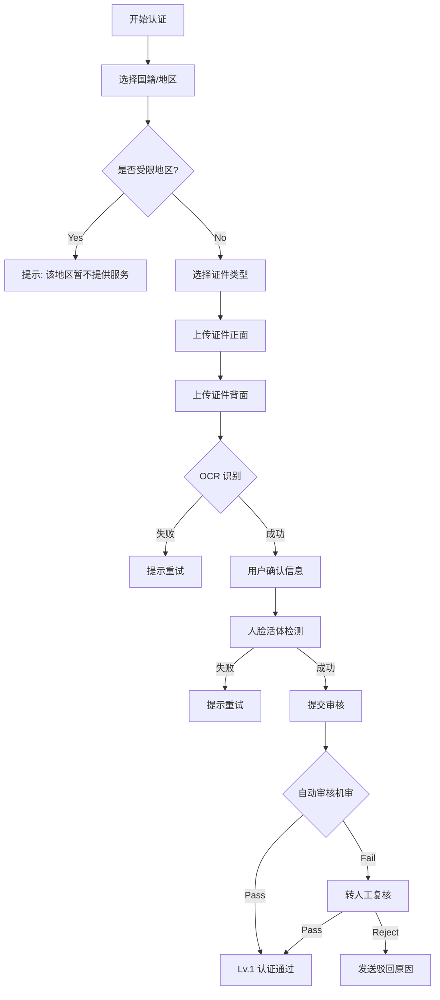

# DeTrade KYC 身份认证系统 PRD

## 1. 文档概述
**项目名称**: DeTrade KYC System
**核心目标**: 满足合规要求 (AML)，防止黑产/羊毛党，保障平台资金安全，同时尽量减少对正常用户的打扰。

---

## 2. 认证等级体系 (Verification Tiers)

### Lv.0: 未认证 (Unverified)
*   **获得方式**: 注册即默认。
*   **权限**:
    *   ✅ 充值 (Crypto Deposit)
    *   ✅ 币币/合约交易
    *   ❌ **提现 (Withdrawal)**: 禁止
    *   ❌ **法币交易 (Fiat)**: 禁止
    *   ❌ **营销活动**: 禁止领取签到/返水/体验金 (防薅核心)

### Lv.1: 基础认证 (Basic) - *标准用户*
*   **认证要求**:
    1.  **国籍选择** (排除受限地区)。
    2.  **证件上传**: 身份证 / 护照 / 驾照 (OCR 识别)。
    3.  **人脸识别**: Liveness Check (活体检测)。
*   **权限**:
    *   ✅ **提现**: 限额 20,000 USDT / 24h。
    *   ✅ **营销活动**: 解锁签到、返水、体验金。
    *   ✅ **法币入金**: 限额 1,000 USDT / 日。

### Lv.2: 高级认证 (Advanced) - *大户/机构*
*   **认证要求**:
    1.  完成 Lv.1。
    2.  **地址证明 (POA)**: 水电煤账单 / 银行对账单 (3个月内)。
*   **权限**:
    *   ✅ **提现**: 限额 500,000 USDT / 24h。
    *   ✅ **法币入金**: 限额 50,000 USDT / 日。
    *   ✅ **Launchpad**: 参与 IEO 认购资格。

---

## 3. 核心业务流程 (Core Workflows)

### 3.1 触发 KYC 的场景 (Trigger Points)

1.  **主动触发**: 用户在 "个人中心 -> 身份认证" 点击认证。
2.  **提现拦截**:
    *   用户点击 "提现" -> 系统判断 `KYC Level < 1` -> 弹窗提示 "为保障资金安全，请先完成身份认证"。
3.  **营销拦截 (薅羊毛防御)**:
    *   用户点击 "每日签到" 或 "领取体验金" -> 系统判断 `KYC Level < 1` -> 弹窗 "实名用户专享福利，请先认证"。
4.  **法币交易拦截**:
    *   进入 "法币买币" 页面 -> 强制跳转 KYC。
5.  **风控被动触发**:
    *   系统监测到异常行为 (如多账号同 IP) -> 将账户状态置为 `Risk_Frozen` -> 强制要求 Lv.2 视频认证解冻。

### 3.2 认证流程 (User Flow)

---

## 4. 功能需求详情 (Functional Requirements)

### 4.1 前端交互 (App/Web)
*   **引导页**: 清晰展示 Lv.1 / Lv.2 的权益对比 (表格形式)。
*   **相机调用**: 调用原生相机进行拍照 (不允许从相册上传，防止 PS 假证)。
*   **状态反馈**:
    *   `Pending`: "审核中，预计 5 分钟内完成"。
    *   `Verified`: "认证成功" (绿色盾牌图标)。
    *   `Rejected`: "认证失败: 证件模糊/过期" (提供“重新认证”按钮)。

### 4.2 后台管理 (Admin)
*   **KYC 审核列表**:
    *   展示所有 `Manual_Review` 状态的申请。
    *   操作: `Pass` / `Reject` (需选择驳回理由)。
*   **用户详情页**:
    *   展示用户当前 KYC 等级、提交的证件图片 (加水印)。
    *   操作: `Reset KYC` (强制重置，要求用户重新认证)。
*   **配置项**:
    *   受限国家列表 (Blacklist Countries)。
    *   自动审核阈值 (Confidence Score)。

---

## 5. 风控与合规 (Risk & Compliance)

*   **数据隐私**: 所有证件图片必须加密存储 (AES-256)，且与业务数据物理隔离。
*   **重复认证**: 同一 ID 号码只能认证一个账号。若尝试认证第二个，提示 "该证件已被占用"。
*   **黑名单**: 接入第三方 AML 数据库 (如 Chainalysis)，自动拒绝制裁名单人员。
