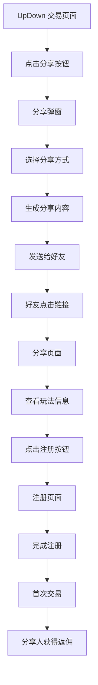

# DeTrade UpDown 分享功能 PRD

## 1. 产品概览

### 1.1 功能描述
- **功能名称**：UpDown 玩法分享功能
- **功能定位**：用户通过分享 UpDown 交易玩法，邀请新用户注册，获得返佣奖励
- **核心价值**：促进平台用户增长，增加 UpDown 玩法的参与度，提升用户粘性

### 1.2 目标用户
- **现有用户**：已经在平台注册并参与 UpDown 交易的用户
- **潜在用户**：通过分享链接/二维码访问平台的新用户

## 2. 核心功能

### 2.1 功能模块

| 模块名称 | 功能描述 | 优先级 |
|---------|---------|--------|
| 分享按钮 | 在 UpDown 交易页面添加分享按钮 | 高 |
| 分享弹窗 | 点击分享按钮后弹出分享选项 | 高 |
| 分享页面 | 生成专属于用户的分享页面 | 高 |
| 邀请信息 | 显示用户的邀请码、邀请链接、邀请二维码 | 高 |
| 对战数据 | 展示 UpDown 对战的获胜奖励比例和历史数据 | 高 |
| 分享统计 | 追踪分享效果和邀请转化数据 | 中 |

### 2.2 页面详情

| 页面名称 | 模块名称 | 功能描述 |
|---------|---------|--------|
| UpDown 交易页面 | 分享按钮 | 位于页面右上角，点击后弹出分享选项 |
| 分享弹窗 | 分享选项 | 提供微信、QQ、复制链接、保存图片等分享方式 |
| 分享弹窗 | 预览功能 | 显示分享页面的预览效果 |
| 分享页面 | 头部信息 | 显示 DeTrade 品牌标识和 UpDown 玩法标题 |
| 分享页面 | 对战区域 | 展示 Up vs Down 的对战视觉效果，突出获胜奖励比例 |
| 分享页面 | 邀请信息 | 显示分享人的邀请码、邀请链接和二维码 |
| 分享页面 | 玩法介绍 | 简要介绍 UpDown 玩法规则和优势 |
| 分享页面 | 注册按钮 | 新用户点击后跳转到注册页面，携带邀请码 |
| 个人中心 | 分享统计 | 显示用户的分享次数、邀请人数、获得的返佣奖励 |

## 3. 核心流程

### 3.1 分享流程
1. 用户进入 UpDown 交易页面
2. 点击分享按钮
3. 选择分享方式（微信、QQ、复制链接、保存图片）
4. 系统生成包含用户邀请信息的分享内容
5. 用户将分享内容发送给好友
6. 好友点击分享链接或扫描二维码
7. 好友进入分享页面，查看 UpDown 玩法信息
8. 好友点击注册按钮，跳转到注册页面（自动携带邀请码）
9. 好友完成注册并首次参与交易
10. 分享人获得返佣奖励

### 3.2 页面流程图

## 4. 用户界面设计

### 4.1 设计风格
- **主色调**：深色主题 (#0F172A)，符合金融交易平台的专业感
- **强调色**：金色 (#F59E0B) 用于 UP 方向，红色 (#EF4444) 用于 DOWN 方向
- **按钮颜色**：紫色 (#8B5CF6) 用于主要 CTA 按钮
- **字体**：Orbitron (标题) + Exo 2 (正文)，体现科技感和未来感
- **视觉风格**：现代、简洁、专业，具有赛博朋克风格的霓虹效果

### 4.2 页面设计概览

| 页面名称 | 模块名称 | UI 元素 |
|---------|---------|--------|
| UpDown 交易页面 | 分享按钮 | 位于页面右上角，使用分享图标，悬停时有动画效果 |
| 分享弹窗 | 整体布局 | 居中弹窗，半透明背景，圆角设计，阴影效果 |
| 分享弹窗 | 分享选项 | 网格布局，每个选项包含图标和文字，悬停时有放大效果 |
| 分享页面 | 头部 | DeTrade 品牌标识，UpDown 玩法标题，霓虹发光效果 |
| 分享页面 | 对战区域 | 左右分栏设计，左侧 UP (绿色)，右侧 DOWN (红色)，中间显示对战数据和奖励比例 |
| 分享页面 | 邀请信息 | 卡片式设计，包含邀请码、邀请链接和二维码，使用渐变背景 |
| 分享页面 | 玩法介绍 | 简洁的文字说明，配合图标，增强可读性 |
| 分享页面 | 注册按钮 | 大尺寸按钮，使用渐变颜色，悬停时有脉冲效果 |

### 4.3 响应式设计
- **桌面端**：完整展示所有内容，布局宽松
- **平板端**：适当调整布局，保持核心功能可见
- **移动端**：垂直布局，优先展示对战区域和邀请信息

## 5. 技术实现

### 5.1 前端技术
- **框架**：React / Vue
- **样式**：Tailwind CSS
- **图标**：Heroicons / Lucide Icons
- **二维码生成**：qrcode.js
- **分享功能**：使用系统分享 API 和自定义分享逻辑

### 5.2 后端技术
- **API**：生成唯一邀请码和邀请链接
- **数据库**：存储用户分享记录和邀请关系
- **统计**：追踪分享效果和转化数据

### 5.3 关键技术点
- **邀请码生成**：确保唯一性和安全性
- **二维码生成**：实时生成包含邀请信息的二维码
- **分享追踪**：通过唯一标识符追踪分享来源
- **返佣计算**：根据邀请关系和交易金额计算返佣

## 6. 业务规则

### 6.1 邀请规则
- **邀请码**：每个用户拥有唯一的邀请码
- **邀请链接**：包含邀请码的唯一链接
- **邀请二维码**：包含邀请链接的二维码

### 6.2 返佣规则
- **返佣比例**：根据平台政策设定，例如被邀请人首次充值的 5%
- **返佣条件**：被邀请人完成注册并进行首次交易
- **返佣上限**：根据用户等级设定不同的返佣上限

### 6.3 分享限制
- **分享频率**：无限制，但建议合理分享
- **分享渠道**：支持主流社交平台

## 7. 数据指标

### 7.1 核心指标
- **分享次数**：用户发起的分享次数
- **点击次数**：分享链接的点击次数
- **注册转化率**：通过分享链接注册的用户比例
- **交易转化率**：通过分享链接注册并进行交易的用户比例
- **返佣金额**：用户通过分享获得的返佣总额

### 7.2 辅助指标
- **分享渠道分布**：不同分享渠道的效果分析
- **设备类型分布**：不同设备的分享和转化情况
- **地域分布**：不同地区的分享效果

## 8. 风险控制

### 8.1 防作弊措施
- **邀请关系验证**：确保邀请关系的真实性
- **交易行为检测**：防止虚假交易和刷返佣行为
- **IP 限制**：防止同一 IP 多次注册

### 8.2 数据安全
- **邀请码保护**：确保邀请码不被恶意利用
- **用户数据保护**：遵守数据隐私法规
- **链接安全**：防止分享链接被篡改

## 9. 上线计划

### 9.1 开发阶段
- **需求分析**：1 天
- **设计阶段**：2 天
- **前端开发**：3 天
- **后端开发**：2 天
- **测试阶段**：2 天

### 9.2 上线准备
- **功能测试**：确保分享功能正常运行
- **性能测试**：确保页面加载速度和响应时间
- **安全测试**：确保数据安全和防作弊措施有效

### 9.3 上线后监控
- **数据分析**：监控分享效果和转化数据
- **用户反馈**：收集用户对分享功能的反馈
- **优化迭代**：根据数据和反馈进行功能优化

## 10. 附录

### 10.1 术语定义
- **UpDown**：平台的一种交易玩法，用户预测价格上涨(UP)或下跌(DOWN)
- **邀请码**：用户专属的邀请标识符
- **邀请链接**：包含邀请码的推广链接
- **返佣**：用户通过邀请新用户获得的奖励

### 10.2 参考资料
- DeTrade 平台现有设计规范
- 主流金融平台分享功能参考
- 用户增长策略最佳实践