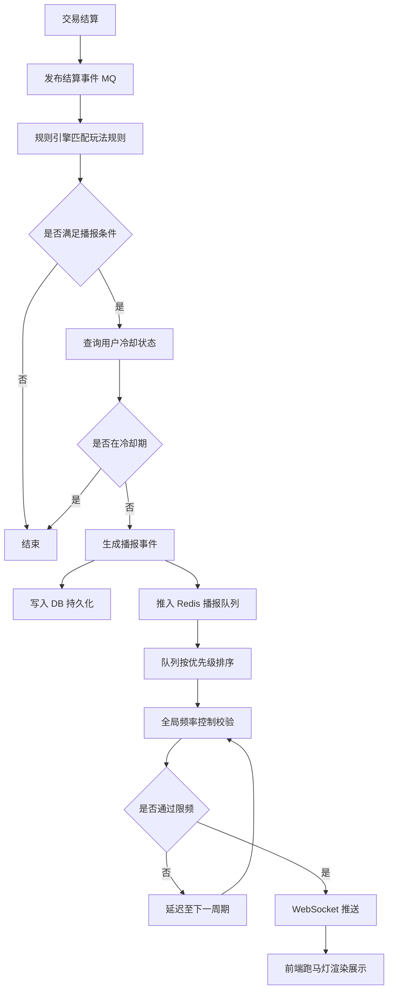
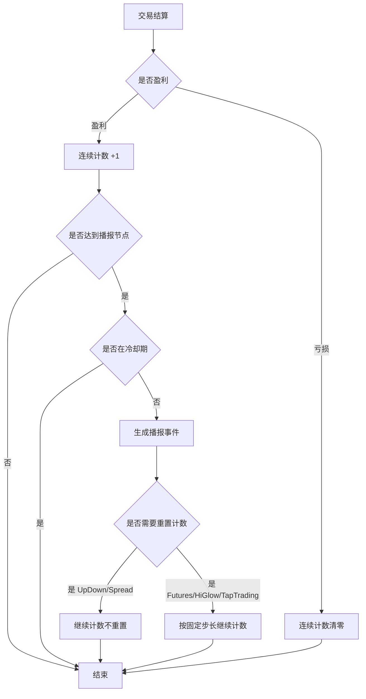

# DeTrade 全平台盈利播报跑马灯 PRD

## 1. 产品概览

### 1.1 功能描述
- **功能名称**：全平台盈利播报跑马灯
- **功能定位**：对全平台所有交易玩法中符合盈利条件的用户交易进行实时播报展示
- **核心价值**：通过展示盈利用户成就，增强平台交易氛围与用户参与感，激励更多用户参与交易，提升整体活跃度

### 1.2 目标用户
- **平台所有用户**：观看跑马灯播报，了解平台交易活跃度和他人盈利情况，增强交易信心
- **被播报用户**：获得成就感与曝光，提升交易积极性
- **运营人员**：通过播报数据监控各玩法活跃度，动态调整播报策略

### 1.3 播报范围
全局所有玩法的符合播报条件的盈利用户交易

## 2. 核心功能

### 2.1 功能模块

| 模块名称 | 功能描述 | 优先级 |
|---------|---------|--------|
| 播报规则引擎 | 根据各玩法规则判断交易是否满足播报条件 | 高 |
| 用户冷却管理 | 维护用户级播报冷却状态，防止同一用户频繁刷屏 | 高 |
| 播报优先级队列 | 按优先级管理播报事件，控制播报顺序 | 高 |
| 全局频率控制 | 控制全局播报频率，避免信息过载 | 高 |
| 前端跑马灯组件 | 实时展示播报内容的滚动组件 | 高 |
| 播报配置管理 | 后台动态配置播报阈值和参数 | 中 |
| 播报数据看板 | 展示播报统计数据和效果分析 | 低 |

### 2.2 玩法播报规则详情

| 玩法 | 播报维度 | 触发条件 | 播报优先级 | 冷却时间 | 计数规则 |
|------|---------|---------|-----------|---------|---------|
| **Futures (合约交易)** | 大额盈利 | 单笔盈利 ≥ 500 USDT | P1 高 | 5 分钟 | 单笔触发 |
| **Futures (合约交易)** | 高倍杠杆盈利 | 杠杆 ≥ 1000 倍 且 单笔盈利 ≥ 100 USDT | P0 极高 | 10 分钟 | 单笔触发 |
| **Futures (合约交易)** | 连续盈利 | 连续盈利 ≥ 10 单 | P3 中 | 10 分钟 | 每满 10 单播报，持续计数 |
| **UpDown (预测涨跌)** | 阶梯连续盈利 | 20局→50局→100局→每+50局 | P4→P3→P2 | 3 分钟 | 播报后不重置，亏损清零 |
| **HiGlow (定期预测)** | 固定连续盈利 | 连续盈利 ≥ 10 单 | P3 中 | 5 分钟 | 每满 10 单播报，持续计数 |
| **Spread (趋势预测)** | 斐波那契连续盈利 | 13单→21单→34单→55单→89单... | P4→P3→P2 | 5 分钟 | 播报后不重置，亏损清零 |
| **TapTrading (网格交易)** | 高倍杠杆盈利 | 杠杆 ≥ 100 倍 且 单笔盈利 ≥ 500 USDT | P0 极高 | 10 分钟 | 单笔触发 |
| **TapTrading (网格交易)** | 大额盈利 | 单笔盈利 ≥ 1000 USDT | P1 高 | 5 分钟 | 单笔触发 |
| **TapTrading (网格交易)** | 连续盈利 | 连续盈利 ≥ 10 单 | P3 中 | 10 分钟 | 每满 10 单播报，持续计数 |

### 2.3 防刷屏机制

| 层级 | 机制 | 参数默认值 | 作用 |
|------|------|-----------|------|
| **L1 用户冷却** | 同一玩法/维度内，同一用户两次播报的最小间隔 | 3~10 分钟（见各玩法表） | 阻断单用户连续曝光 |
| **L2 窗口去重** | 1 分钟内同一用户仅允许 1 条播报存在于队列 | 1 分钟滑动窗口 | 防止并发结算导致重复入队 |
| **L3 全局限频** | 全平台跑马灯两条播报的最小时间间隔 | ≥ 3 秒/条，≤ 20 条/分钟 | 保证用户阅读体验，防信息过载 |
| **L4 队列容量** | 播报队列最大长度，满队列时丢弃策略 | 50 条，满时丢弃低优先级 | 防内存堆积与延迟放大 |

## 3. 核心流程

### 3.1 播报事件流转流程
1. 用户交易完成并结算
2. 结算服务发布交易结算事件至消息队列
3. 播报规则引擎消费事件，匹配对应玩法的播报规则
4. 判断是否满足播报条件（盈利金额、杠杆倍数、连续盈利次数等）
5. 查询用户冷却状态（Redis），判断是否在冷却期内
6. 若在冷却期内，丢弃该播报事件；若不在，生成播报事件
7. 将播报事件写入数据库（持久化），并推入 Redis 播报优先级队列
8. 播报调度服务消费队列，按优先级排序
9. 进行全局频率控制校验（令牌桶机制）
10. 通过 WebSocket 推送至前端跑马灯组件
11. 前端渲染展示播报内容

### 3.2 页面流程图


### 3.3 连续盈利计数流程


## 4. 用户界面设计

### 4.1 设计风格
- **主色调**：深色主题 (#0F172A)，与平台整体风格保持一致
- **播报背景**：半透明深色卡片 (#1E293B / 80% 透明度)
- **文字颜色**：白色 (#F8FAFC)，关键数据使用金色 (#F59E0B) 高亮
- **字体**：Exo 2 (正文)，数字使用等宽字体确保对齐
- **视觉风格**：现代、简洁，带有微弱发光效果突出播报重要性

### 4.2 跑马灯组件设计

| 模块名称 | UI 元素 | 说明 |
|---------|--------|------|
| 播报容器 | 通栏横幅 | 固定宽度，高度约 40px，位于页面顶部 |
| 播报图标 | 表情符号/图标 | 根据播报类型显示不同图标（🎉 🔥 📈 ⚡ 📊 💹） |
| 用户昵称 | 脱敏显示 | 根据脱敏规则显示部分字符 |
| 播报文案 | 动态文字 | 根据玩法和播报维度生成对应文案 |
| 滚动动画 | 从右向左匀速滚动 | 速度约 3-5 秒/条，悬停暂停 |
| 点击交互 | 可点击 | 点击跳转至对应玩法页面 |

### 4.3 播报类型与样式映射

| 播报类型 | 图标 | 文字高亮色 | 背景装饰 |
|---------|------|-----------|---------|
| 大额盈利 | 🎉 | 金色 (#F59E0B) | 金币粒子效果 |
| 高倍杠杆 | 🔥 | 红色 (#EF4444) | 火焰微动效 |
| Futures 连续盈利 | 📈 | 绿色 (#22C55E) | 上升箭头装饰 |
| UpDown 连续盈利 | ⚡ | 蓝色 (#3B82F6) | 闪电微光效果 |
| HiGlow 连续盈利 | 📊 | 青色 (#06B6D4) | 柱状图装饰 |
| Spread 连续盈利 | 💹 | 紫色 (#8B5CF6) | 趋势线装饰 |

### 4.4 响应式设计
- **桌面端**：完整跑马灯展示，支持同时显示 2 条（优先级高的置顶）
- **移动端**：单条跑马灯展示，垂直堆叠时依次滚动
- **平板端**：同桌面端布局，适当调整字体大小

## 5. 技术实现

### 5.1 前端技术
- **框架**：React / Vue（与平台现有框架保持一致）
- **样式**：Tailwind CSS
- **动画**：CSS Animation / Framer Motion（跑马灯滚动效果）
- **实时通信**：WebSocket（接收服务端推送的播报事件）
- **状态管理**：Redux / Pinia（管理播报队列状态）

### 5.2 后端技术
- **消息队列**：Kafka / RabbitMQ（交易结算事件分发）
- **规则引擎**：轻量级规则匹配服务（可考虑 Drools 或自研）
- **缓存**：Redis（冷却状态、连续计数、播报队列）
- **数据库**：MySQL（播报事件持久化）
- **推送服务**：WebSocket Server（实时推送至前端）

### 5.3 数据结构设计

#### 播报事件表（t_broadcast_event）

```sql
CREATE TABLE t_broadcast_event (
    id              BIGINT PRIMARY KEY AUTO_INCREMENT COMMENT '主键ID',
    user_id         BIGINT NOT NULL COMMENT '用户ID',
    user_name       VARCHAR(64) NOT NULL COMMENT '用户昵称（原始）',
    display_name    VARCHAR(64) NOT NULL COMMENT '脱敏后展示昵称',
    game_type       VARCHAR(32) NOT NULL COMMENT '玩法类型: futures/updown/higlow/spread/taptrading',
    broadcast_type  VARCHAR(32) NOT NULL COMMENT '播报类型: large_profit/high_leverage/streak_win',
    profit_amount   DECIMAL(18,2) COMMENT '盈利金额（USDT）',
    leverage        INT COMMENT '杠杆倍数',
    streak_count    INT COMMENT '连续盈利次数',
    extra_data      JSON COMMENT '扩展数据（如额外播报参数等）',
    priority        TINYINT NOT NULL COMMENT '优先级: 0-极高 1-高 2-中高 3-中 4-基础',
    status          TINYINT DEFAULT 0 COMMENT '状态: 0-待播报 1-已播报 2-已取消 3-已过期',
    created_at      DATETIME NOT NULL DEFAULT CURRENT_TIMESTAMP COMMENT '创建时间',
    broadcast_at    DATETIME COMMENT '实际播报时间',
    updated_at      DATETIME DEFAULT CURRENT_TIMESTAMP ON UPDATE CURRENT_TIMESTAMP COMMENT '更新时间',
    INDEX idx_user_id (user_id),
    INDEX idx_status_created (status, created_at),
    INDEX idx_priority_status (priority, status),
    INDEX idx_game_type (game_type)
) ENGINE=InnoDB DEFAULT CHARSET=utf8mb4 COMMENT='播报事件表';
```

#### 用户冷却记录表（t_user_broadcast_cooldown）

```sql
CREATE TABLE t_user_broadcast_cooldown (
    id              BIGINT PRIMARY KEY AUTO_INCREMENT COMMENT '主键ID',
    user_id         BIGINT NOT NULL COMMENT '用户ID',
    game_type       VARCHAR(32) NOT NULL COMMENT '玩法类型',
    broadcast_type  VARCHAR(32) NOT NULL COMMENT '播报类型',
    last_broadcast  DATETIME NOT NULL COMMENT '上次播报时间',
    cooldown_until  DATETIME NOT NULL COMMENT '冷却结束时间',
    created_at      DATETIME NOT NULL DEFAULT CURRENT_TIMESTAMP COMMENT '创建时间',
    updated_at      DATETIME DEFAULT CURRENT_TIMESTAMP ON UPDATE CURRENT_TIMESTAMP COMMENT '更新时间',
    UNIQUE KEY uk_user_game_type (user_id, game_type, broadcast_type),
    INDEX idx_cooldown_until (cooldown_until)
) ENGINE=InnoDB DEFAULT CHARSET=utf8mb4 COMMENT='用户播报冷却记录表';
```

### 5.4 缓存设计（Redis）

| Key 格式 | 类型 | TTL | 说明 |
|---------|------|-----|------|
| `broadcast:cooldown:{user_id}:{game_type}:{broadcast_type}` | String | 动态 | 冷却截止时间戳（毫秒） |
| `broadcast:streak:{user_id}:{game_type}` | String | 7 天 | 当前连续盈利计数 |
| `broadcast:queue` | ZSet | 持久 | 播报优先级队列，score = priority × 10000 + timestamp |
| `broadcast:rate:{minute_timestamp}` | String | 120 秒 | 分钟级全局播报计数器 |
| `broadcast:dedup:{user_id}:{minute_timestamp}` | String | 120 秒 | 用户分钟级去重标记 |

### 5.5 关键技术点
- **播报规则引擎**：支持热更新规则配置，无需重启服务
- **优先级队列排序**：使用 Redis ZSet，score 设计保证高优先级+时间早的事件优先出队
- **全局限频令牌桶**：使用 Redis + Lua 脚本实现原子性令牌桶算法
- **分布式锁**：用户维度冷却状态更新使用分布式锁保证原子性
- **WebSocket 推送**：支持断线重连与历史补播机制

## 6. 业务规则

### 6.1 播报优先级体系

| 优先级 | 标识 | 典型场景 | 队列满时策略 | 限流时策略 |
|:---:|:---:|---------|-------------|-----------|
| **P0** | 极高 | 高倍杠杆盈利 | 永不丢弃 | 优先保留 |
| **P1** | 高 | 大额盈利（≥1000 USDT） | 队列满时保留 | 优先保留 |
| **P2** | 中高 | UpDown≥100局 / Spread≥55单 / 其他高阶连续 | 限流时优先保留 | 优先保留 |
| **P3** | 中 | 常规连续盈利播报 | 正常调度 | 正常调度 |
| **P4** | 基础 | 各玩法首次达标 | 队列满时优先丢弃 | 限流时优先丢弃 |

### 6.2 播报文案模板

| 玩法 | 播报类型 | 文案模板 |
|------|---------|---------|
| Futures | 大额盈利 | `🎉 {user_name} 在合约交易盈利 {profit_amount} USDT` |
| Futures | 高倍杠杆 | `🔥 {user_name} 使用 {leverage} 倍杠杆盈利 {profit_amount} USDT` |
| Futures | 连续盈利 | `📈 {user_name} 连续盈利 {streak_count} 单合约，累计盈利 {profit_amount} USDT` |
| UpDown | 阶梯连续 | `⚡ {user_name} 在涨跌预测中连续盈利 {streak_count} 局` |
| HiGlow | 固定连续 | `📊 {user_name} 在定期预测中连续盈利 {streak_count} 单` |
| Spread | 斐波那契连续 | `💹 {user_name} 在趋势预测中连续盈利 {streak_count} 单，累计盈利 {profit_amount} USDT` |
| TapTrading | 高倍杠杆 | `🔥 {user_name} 使用 {leverage} 倍杠杆进行网格交易，盈利 {profit_amount} USDT` |
| TapTrading | 大额盈利 | `🎉 {user_name} 在网格交易盈利 {profit_amount} USDT` |
| TapTrading | 连续盈利 | `📈 {user_name} 连续盈利 {streak_count} 单网格，累计盈利 {profit_amount} USDT` |

### 6.3 用户昵称脱敏规则

| 原始昵称长度 | 脱敏规则 | 示例 |
|-------------|---------|------|
| ≤ 4 字符 | 保留首尾各 1 位，中间用 `*` 填充 | `A**B` |
| 5 ~ 8 字符 | 保留首 2 尾 2 位，中间用 `**` 填充 | `Ab**XY` |
| > 8 字符 | 保留首 3 尾 3 位，中间用 `***` 填充 | `Abc***XYZ` |

### 6.4 计数重置规则

| 玩法 | 播报后计数处理 | 亏损处理 |
|------|--------------|---------|
| Futures | 继续计数，每满 5 单播报一次 | 连续计数清零 |
| UpDown | 继续计数，按阶梯节点播报 | 连续计数清零 |
| HiGlow | 继续计数，每满 10 单播报一次 | 连续计数清零 |
| Spread | 继续计数，按斐波那契节点播报 | 连续计数清零 |
| TapTrading | 继续计数，每满 10 单播报一次 | 连续计数清零 |

### 6.5 播报冲突处理

| 场景 | 处理策略 |
|------|---------|
| 同一笔交易同时触发多个播报维度 | 按 P0 > P1 > P2 > P3 > P4 选取最高优先级播报，低优先级事件记录日志但不入队 |
| 同一用户在不同玩法同时触发播报 | 按优先级排序入队，受用户冷却限制（不同玩法独立冷却） |
| 用户冷却期结束时队列中有多条该用户播报 | 仅保留最新一条，其余标记为已取消 |

### 6.6 极端行情处理

| 场景 | 阈值 | 处理策略 |
|------|------|---------|
| 1 分钟内播报事件超过 100 条 | > 100 条/分钟 | 触发熔断：仅放行 P0/P1，P2~P4 合并为汇总播报 |
| 汇总播报文案 | - | `🌍 过去 1 分钟共有 {count} 位用户实现连续盈利` |
| 队列积压超过 100 条 | > 100 条 | 告警通知运维，加速消费或扩容 |

## 7. 数据指标

### 7.1 核心指标

| 指标名称 | 说明 | 计算方式 |
|---------|------|---------|
| 播报总量 | 每日播报总数 | COUNT(status = 1) WHERE broadcast_at 在当日 |
| 各玩法播报占比 | 反映各玩法活跃度 | 按 game_type 分组统计 |
| 播报触达率 | 播报被前端成功展示的比例 | 前端成功展示数 / 推送总数 |
| 平均播报延迟 | 从交易结算到前端展示的时延 | AVG(broadcast_at - created_at) |
| 限流触发次数 | 反映播报系统压力 | COUNT(被限流丢弃的事件) |
| 用户覆盖率 | 被播报过的独立用户数 | COUNT(DISTINCT user_id) |

### 7.2 辅助指标

| 指标名称 | 说明 |
|---------|------|
| 播报点击率 | 用户点击播报跳转至玩法页面的比例 |
| 播报转化率 | 通过播报跳转后产生交易的用户比例 |
| 各时段播报分布 | 分析不同时间段的播报频率和用户活跃度 |
| 高价值用户播报占比 | P0/P1 级别播报占总播报的比例 |

## 8. 风险控制

### 8.1 防作弊措施

| 风险类型 | 防护措施 |
|---------|---------|
| 刷单播报 | 同一用户同一玩法设置冷却时间，限制播报频率 |
| 对敲交易 | 结合风控系统识别异常交易模式，标记异常播报 |
| 虚假连续盈利 | 严格以结算单为准，仅统计真实盈利交易 |
| 机器人刷播报 | 结合用户行为分析，识别并过滤机器人产生的播报 |

### 8.2 数据安全

| 安全项 | 防护措施 |
|-------|---------|
| 用户隐私 | 昵称脱敏展示，不暴露完整用户信息 |
| 金额数据 | 播报金额仅展示脱敏后的近似值（可选） |
| 接口安全 | WebSocket 连接需认证，防止未授权推送 |
| 数据完整性 | 播报事件持久化，支持审计与回溯 |

### 8.3 系统稳定性

| 风险场景 | 应对策略 |
|---------|---------|
| 消息队列积压 | 监控队列深度，设置告警，支持消费者水平扩容 |
| Redis 故障 | 冷却状态和队列可降级从 DB 读取，保证核心功能可用 |
| WebSocket 断连 | 前端支持自动重连，重连后补播最近 N 条（默认 5 条） |
| 服务宕机重启 | 调度服务启动时从 DB 读取 status=0 且未超时的记录重新入队 |

## 9. 后台配置管理

### 9.1 可配置参数

| 配置分组 | 配置 Key | 默认值 | 说明 |
|---------|---------|:-----:|------|
| `futures` | `large_profit_threshold` | 1000 | 大额盈利阈值（USDT） |
| `futures` | `leverage_min_leverage` | 100 | 高倍杠杆最低倍数 |
| `futures` | `leverage_min_profit` | 100 | 高倍杠杆最低盈利（USDT） |
| `futures` | `streak_interval` | 5 | 连续盈利播报步长 |
| `futures` | `streak_cooldown` | 600 | 连续盈利冷却时间（秒） |
| `futures` | `large_profit_cooldown` | 300 | 大额盈利冷却时间（秒） |
| `futures` | `high_leverage_cooldown` | 600 | 高倍杠杆冷却时间（秒） |
| `updown` | `streak_tiers` | `[20,50,100,150,200...]` | 阶梯播报节点数组 |
| `updown` | `streak_cooldown` | 180 | 播报冷却时间（秒） |
| `higlow` | `streak_interval` | 10 | 固定播报间隔（单数） |
| `higlow` | `streak_cooldown` | 300 | 播报冷却时间（秒） |
| `spread` | `streak_sequence` | `[13,21,34,55,89,144...]` | 斐波那契播报节点数组 |
| `spread` | `streak_cooldown` | 300 | 播报冷却时间（秒） |
| `taptrading` | `leverage_min_leverage` | 100 | 高倍杠杆最低倍数 |
| `taptrading` | `high_leverage_min_profit` | 500 | 高倍杠杆最低盈利（USDT） |
| `taptrading` | `large_profit_threshold` | 1000 | 大额盈利阈值（USDT） |
| `taptrading` | `streak_interval` | 5 | 连续盈利播报步长 |
| `taptrading` | `streak_cooldown` | 600 | 连续盈利冷却时间（秒） |
| `global` | `min_interval_sec` | 3 | 全局最小播报间隔（秒） |
| `global` | `max_per_minute` | 20 | 全局每分钟最大播报数 |
| `global` | `queue_max_size` | 50 | 队列容量上限 |
| `global` | `circuit_breaker_threshold` | 100 | 熔断触发阈值（条/分钟） |
| `global` | `replay_count` | 5 | 断线重连补播数量 |

### 9.2 配置热更新机制
- 使用配置中心（Nacos / Apollo）管理所有播报参数
- 配置变更即时生效，无需重启播报服务
- 支持配置版本管理与回滚
- 关键配置变更需记录操作日志

## 10. 上线计划

### 10.1 版本规划

| 版本 | 范围 | 交付物 |
|:---:|------|--------|
| **V1.0 (MVP)** | 5 种玩法基础播报规则 + 用户冷却 + 全局限频 + 前端基础跑马灯 | 核心链路跑通，阈值硬编码 |
| **V1.5** | 播报后台配置化 + 断线补播 + 数据埋点 | 运营可自助调整阈值 |
| **V2.0** | 播报效果看板（展示量/点击率/玩法转化）+ 智能动态阈值（按时段/活跃度自动调节） | 数据驱动运营优化 |

### 10.2 V1.0 开发阶段

| 阶段 | 主要工作 | 交付物 |
|------|---------|--------|
| 需求评审 | 确认播报规则、防刷屏机制、优先级设计 | 评审通过的 PRD |
| 技术设计 | 数据库表设计、缓存设计、接口定义 | 技术方案文档 |
| 后端开发 | 规则引擎、冷却管理、队列服务、WebSocket 推送 | 后端服务代码 |
| 前端开发 | 跑马灯组件、WebSocket 接入、动画效果 | 前端组件代码 |
| 联调测试 | 前后端联调、播报流程验证 | 联调报告 |
| 压力测试 | 使用历史交易数据回放压测 | 压测报告 |

### 10.3 上线准备

| 检查项 | 标准 |
|-------|------|
| 功能测试 | 5 种玩法播报规则全部验证通过 |
| 防刷屏测试 | 用户冷却、窗口去重、全局限频、队列丢弃全部验证通过 |
| 性能测试 | 播报延迟 < 2 秒，队列不积压，支持 1000 TPS 交易结算 |
| 安全测试 | 昵称脱敏验证通过，WebSocket 认证验证通过 |
| 兼容性测试 | 桌面端/移动端/平板端跑马灯渲染正常 |

### 10.4 上线后监控

| 监控项 | 告警阈值 | 处理预案 |
|-------|---------|---------|
| 播报延迟 | > 5 秒 | 检查队列积压，必要时扩容消费者 |
| 队列积压 | > 100 条 | 告警通知运维，加速消费 |
| 限流触发频率 | > 10 次/分钟 | 考虑调整播报阈值或全局限频参数 |
| 播报失败率 | > 5% | 检查 WebSocket 连接状态，排查推送服务异常 |
| 熔断触发 | 触发熔断 | 记录熔断日志，分析是否异常行情 |

## 11. 附录

### 11.1 术语定义

| 术语 | 定义 |
|------|------|
| **Futures** | 合约交易玩法，支持最高 1000 倍杠杆 |
| **UpDown** | 预测币价涨跌玩法，最短 5 秒一局 |
| **HiGlow** | 预测定期价格涨跌玩法，最短 5 秒、最长 2 分钟结算 |
| **Spread** | 预测币价涨跌趋势玩法，包含点差机制，最短 5 秒、最长 1 分钟结算 |
| **TapTrading** | K 线网格形式预测币价涨跌玩法 |
| **跑马灯** | 全局播报组件，以滚动方式展示符合播报条件的用户交易信息 |
| **冷却时间** | 同一用户两次播报之间的最小时间间隔 |
| **播报优先级** | P0（极高）到 P4（基础）五级优先级体系 |
| **连续盈利** | 用户连续盈利的交易单数/局数，期间无亏损单 |

### 11.2 斐波那契数列参考

Spread 玩法播报节点使用的斐波那契数列（取 ≥ 13 的项）：

```
13, 21, 34, 55, 89, 144, 233, 377, 610, 987, 1597, 2584, ...
```

计算方式：F(n) = F(n-1) + F(n-2)，其中 F(7) = 13, F(8) = 21

### 11.3 播报优先级 Score 计算

Redis ZSet 播报队列的 Score 计算方式：

```
Score = Priority × 10,000,000,000 + (MAX_TIMESTAMP - Timestamp)
```

其中：
- `Priority`：0 ~ 4（P0 为 0，P4 为 4）
- `Timestamp`：事件创建时间戳（毫秒）
- `MAX_TIMESTAMP`：最大时间戳常量（如 9999999999999）

该设计确保：
1. 优先级高的事件 score 更小，优先出队
2. 同优先级下，时间早的事件 score 更小，优先出队（FIFO）

### 11.4 参考资料

- DeTrade 平台现有设计规范
- 主流交易平台跑马灯/播报功能参考
- Redis ZSet 优先级队列最佳实践
- WebSocket 实时推送技术方案
