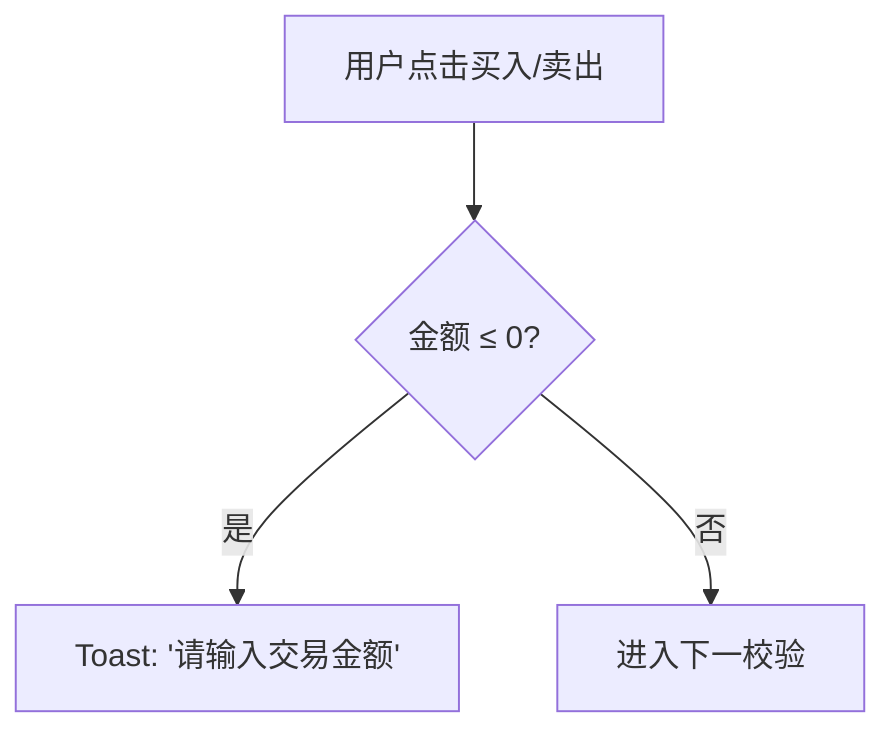
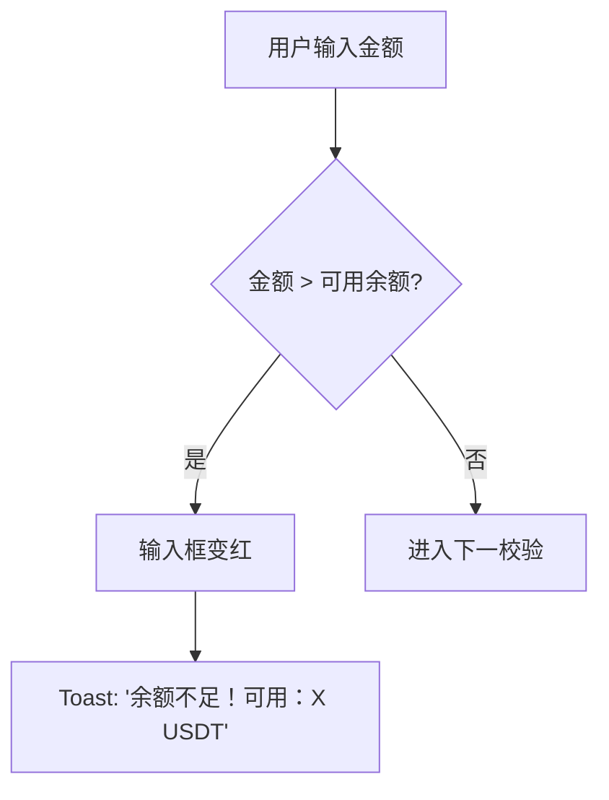
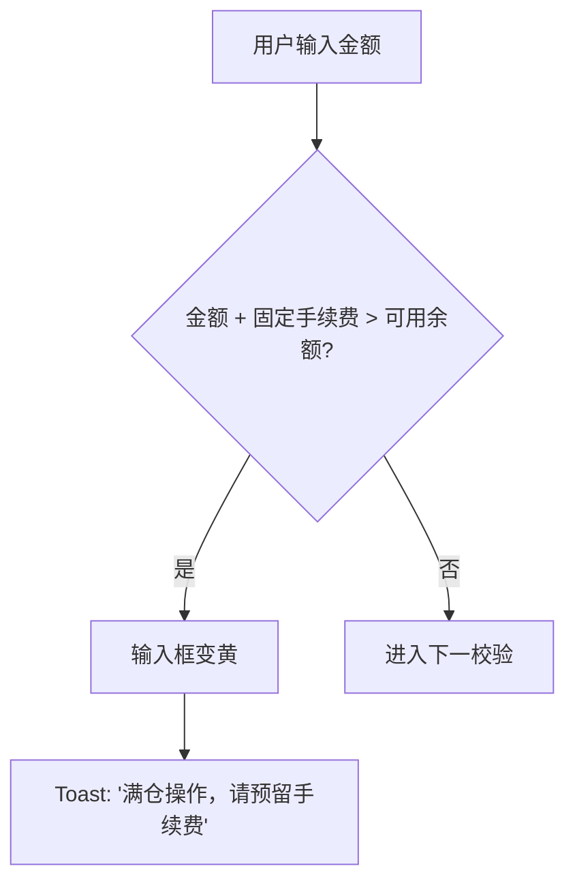
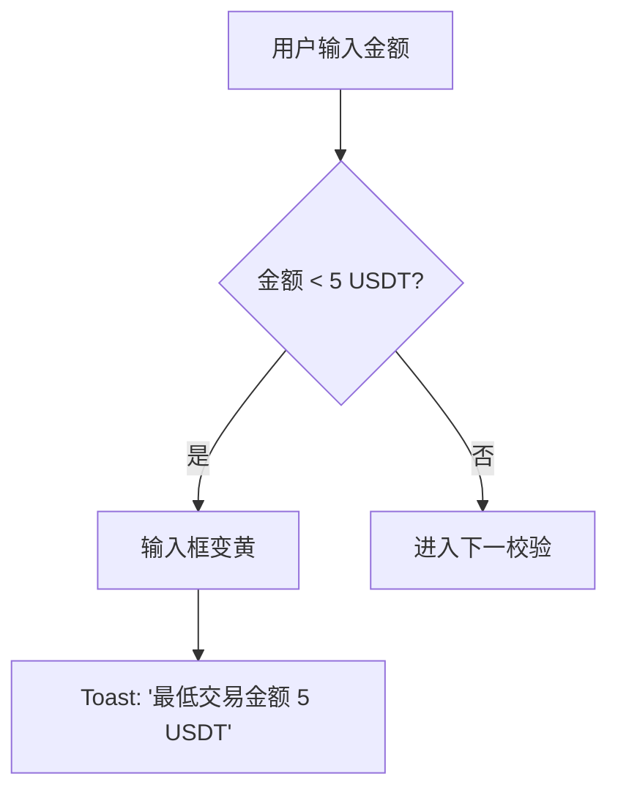
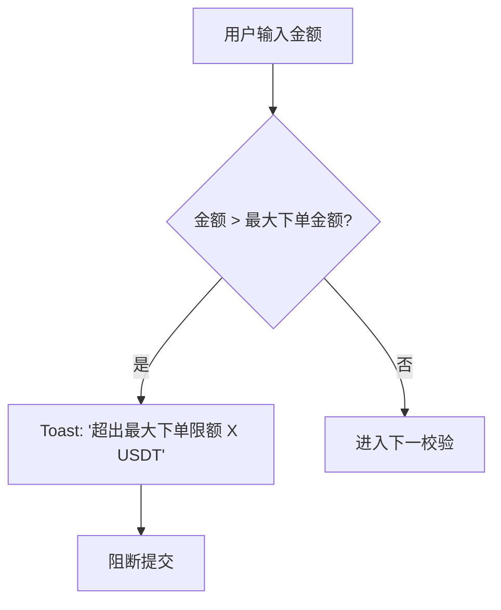
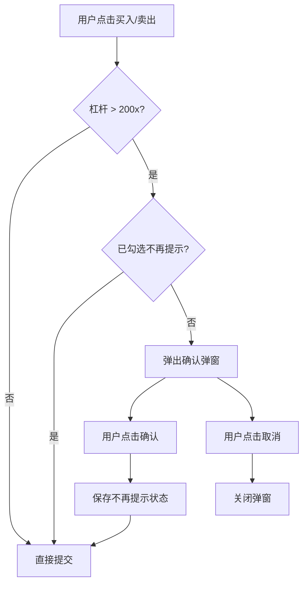
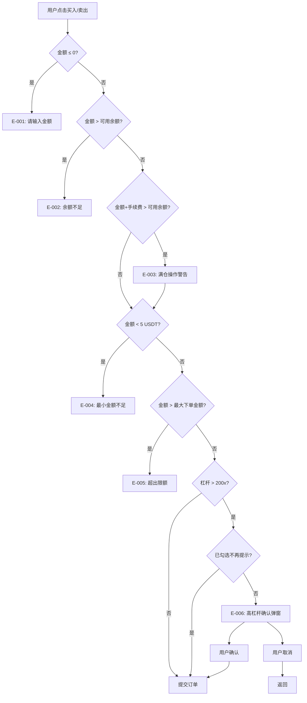

# CEX交易区交互PRD文档

## 1. 产品概述

### 1.1 背景

基于对主流CEX平台（Binance、OKX、Bybit、KuCoin）交易区交互设计的调研分析，结合实际交互测试反馈，对交易区（下单区）进行系统性优化，提升用户交易体验和风险控制能力。

### 1.2 核心目标

- 优化杠杆选择交互体验
- 完善金额输入与确认机制
- 强化风险提示与确认流程

***

## 2. 功能模块说明

### 2.1 杠杆选择模块

#### 2.1.1 杠杆范围

- **最小值**：1x
- **最大值**：1000x
- **默认值**：20x

#### 2.1.2 风险等级划分

| 杠杆范围         | 风险等级 | 视觉标识 | 交互行为              |
| ------------ | ---- | ---- | ----------------- |
| 1x - 100x    | 低风险  | 绿色   | 无额外提示             |
| 101x - 200x  | 中风险  | 黄色   | 无额外提示             |
| 201x - 500x  | 高风险  | 橙色   | 提交时弹出确认弹窗         |
| 501x - 1000x | 极高风险 | 红色   | 提交时弹出确认弹窗 + 强风险提示 |

#### 2.1.3 交互特性

- 滑块支持拖拽选择
- 滑块轨道支持点击定位
- 显示关键档位标记（1x、100x、200x、500x、750x、1000x）
- 点击"最大"按钮快速设置为1000x

***

### 2.2 订单类型模块

| 类型     | 名称（中文）  | 名称（英文）       | 功能描述           |
| ------ | ------- | ------------ | -------------- |
| market | 市场订单    | Market Order | 按当前市价立即成交      |
| limit  | 限价订单    | Limit Order  | 用户指定价格，达到条件时成交 |
| tpsl   | TP/SL订单 | TP/SL Order  | 止盈止损订单，自动平仓    |

#### 2.2.1 限价订单交互

- 价格输入框，支持数字输入
- 显示当前价格与输入价格的百分比差异
- 占位符提示"请输入价格"

#### 2.2.2 TP/SL订单交互

- 支持市场/限价两种模式选择
- 止盈价输入，显示预估收益
- 止损价输入，显示预估亏损
- 收益/亏损金额实时计算

***

### 2.3 金额输入模块

#### 2.3.1 核心功能

- USDT金额输入框
- 百分比快捷按钮（0%、25%、50%、75%、100%）
- 快捷操作按钮（1/2、2x、T）
- 自定义百分比滑块

#### 2.3.2 滑块交互特性

- 支持拖拽调整百分比
- 支持点击轨道任意位置快速定位
- 实时显示当前百分比对应的金额
- 滑块填充区域动态变化

***

### 2.4 操作按钮模块

#### 2.4.1  强平价显示

- 买入按钮下方显示买入强平价（左对齐）
- 卖出按钮下方显示卖出强平价（右对齐）
- 强平价根据杠杆和金额实时计算

***

### 2.5 ROI计算器模块

#### 2.5.1 触发方式

- 点击杠杆行右侧计算器图标打开弹窗
- 弹窗从底部滑入

#### 2.5.2 计算器功能

- 开仓价输入
- 交易方向选择（看涨/看跌）
- 交易量输入（USD）
- 收益倍数输入
- 自定义价格波动百分比输入
- ROI表格实时计算展示

***

### 2.6 确认弹窗模块

#### 2.6.1 触发条件

- 杠杆 > 200x 且未勾选"不再提示"

#### 2.6.2 弹窗内容

- 订单确认信息（方向、类型、杠杆、金额）
- 风险提示（高杠杆/极高杠杆）
- "不再提示"勾选框
- 取消/确认按钮

#### 2.6.3 风险提示文案

| 杠杆范围       | 提示级别 | 文案内容（中文）                    | 文案内容（英文）                                                                                        |
| ---------- | ---- | --------------------------- | ----------------------------------------------------------------------------------------------- |
| 201x-500x  | 高风险  | ⚠️ 高风险！您正在使用高杠杆，请注意风险控制。    | ⚠️ High Risk! You are using high leverage, please manage your risk.                             |
| 501x-1000x | 极高风险 | ⚠️ 极高风险！您正在使用超高杠杆，可能导致快速爆仓！ | ⚠️ Extremely High Risk! You are using ultra-high leverage, which may lead to rapid liquidation! |

***

### 2.7 多语言支持模块

#### 2.7.1 支持语言

- 中文（默认）
- English

#### 2.7.2 切换方式

- 点击页面右上角语言切换按钮
- 切换后立即更新所有界面文本

***

## 3. 异常场景判定条件与流程

### 3.1 异常场景总览

| 场景ID  | 场景名称     | 触发条件                 | 提示方式          | 阻断操作     |
| ----- | -------- | -------------------- | ------------- | -------- |
| E-001 | 金额未输入    | 金额 ≤ 0               | Toast提示       | 是        |
| E-002 | 余额不足     | 金额 > 可用余额            | 输入框红色 + Toast | 是        |
| E-003 | 满仓操作     | 金额 + 固定手续费 > 可用余额    | 输入框黄色 + Toast | 否（可继续提交） |
| E-004 | 最小金额不足   | 金额 < 最小名义价值（5 USDT）  | 输入框黄色 + Toast | 是        |
| E-005 | 超过最大下单金额 | 金额 > 当前交易对+杠杆限制的最大金额 | Toast提示       | 是        |
| E-006 | 高杠杆确认    | 杠杆 > 200x 且未勾选不再提示   | 确认弹窗          | 是（需确认）   |

***

### 3.2 各场景判定条件与流程

#### E-001：金额未输入

**判定条件**

- 输入金额 ≤ 0

**判定流程**

**提示文案**

| 语言 | 提示文案                        |
| -- | --------------------------- |
| 中文 | 请输入交易金额                     |
| 英文 | Please enter trading amount |

***

#### E-002：余额不足

**判定条件**

- 输入金额 > 可用余额

**判定流程**

**提示文案**

| 语言 | 提示文案                                    |
| -- | --------------------------------------- |
| 中文 | 余额不足！可用：X USDT                          |
| 英文 | Insufficient balance! Available: X USDT |

***

#### E-003：满仓操作

**判定条件**

- 下单金额 + 固定手续费 > 可用余额

**手续费说明**

| 手续费类型 | 收取时机  | 计算方式          |
| ----- | ----- | ------------- |
| 固定手续费 | 下单时收取 | 开仓手续费 + 平仓手续费 |
| 收益手续费 | 平仓后收取 | 仅对盈利仓位收取      |

**判定流程**

**提示文案**

| 语言 | 提示文案                             |
| -- | -------------------------------- |
| 中文 | 满仓操作，请预留手续费                      |
| 英文 | Full position, reserve fee space |

***

#### E-004：最小金额不足

**判定条件**

- 金额 < 最小名义价值（默认 5 USDT）

**判定流程**

**提示文案**

| 语言 | 提示文案              |
| -- | ----------------- |
| 中文 | 最低交易金额 5 USDT     |
| 英文 | Min amount 5 USDT |

***

#### E-005：超过最大下单金额

**判定条件**

- 输入金额 > 当前交易对 + 杠杆倍数所限制的最大下单金额

**说明**

- 系统会根据不同的交易对和杠杆倍数设置不同的最大下单金额限制
- 该限制值由后端配置，前端通过接口获取
- 当用户选择不同交易对或调整杠杆时，最大下单金额限制会动态变化

**判定流程**

**提示文案**

| 语言 | 提示文案                |
| -- | ------------------- |
| 中文 | 超出最大下单限额 X USDT     |
| 英文 | Exceeds max  X USDT |

**交互行为**

- 显示Toast提示，说明当前限制金额
- 阻断订单提交
- 用户需降低金额至限制范围内

***

#### E-006：高杠杆确认

**判定条件**

- 杠杆 > 200x
- 用户未勾选"不再提示"

**判定流程**

**提示文案**

| 杠杆范围       | 提示级别 | 中文文案              | 英文文案                                                   |
| ---------- | ---- | ----------------- | ------------------------------------------------------ |
| 201x-500x  | 高风险  | ⚠️ 高风险！请注意风险控制。   | ⚠️ High Risk! Please manage your risk.                 |
| 501x-1000x | 极高风险 | ⚠️ 极高风险！可能导致快速爆仓！ | ⚠️ Extremely High Risk! May lead to rapid liquidation! |

***

### 3.3 完整校验流程

***

## 4. 交互节点说明

### 4.1 核心交互节点

| 节点ID   | 节点名称     | 触发方式       | 响应行为          |
| ------ | -------- | ---------- | ------------- |
| IN-001 | 杠杆滑块拖拽   | 鼠标/触摸拖拽滑块  | 更新杠杆值，实时计算强平价 |
| IN-002 | 杠杆滑块点击   | 点击滑块轨道     | 跳转到对应杠杆值      |
| IN-003 | 最大杠杆按钮   | 点击"最大"按钮   | 设置杠杆为1000x    |
| IN-004 | 订单类型切换   | 点击Tab标签    | 切换显示对应订单输入区域  |
| IN-005 | 金额输入     | 输入框输入      | 实时校验，更新百分比滑块  |
| IN-006 | 百分比快捷按钮  | 点击百分比标记    | 设置对应百分比金额     |
| IN-007 | 金额滑块拖拽   | 鼠标/触摸拖拽    | 更新百分比和金额      |
| IN-008 | 金额滑块点击   | 点击轨道任意位置   | 跳转到对应百分比      |
| IN-009 | 快捷操作按钮   | 点击1/2、2x、T | 快速调整金额        |
| IN-010 | 买入按钮     | 点击买入按钮     | 触发交易提交流程      |
| IN-011 | 卖出按钮     | 点击卖出按钮     | 触发交易提交流程      |
| IN-012 | ROI计算器图标 | 点击计算器图标    | 打开ROI计算器弹窗    |
| IN-013 | 确认弹窗确认   | 点击确认按钮     | 提交订单并保存偏好设置   |
| IN-014 | 确认弹窗取消   | 点击取消按钮     | 关闭弹窗，不提交订单    |
| IN-015 | 语言切换     | 点击语言按钮     | 切换界面语言        |

### 4.2 状态转换节点

| 状态    | 触发条件            | 下一状态             |
| ----- | --------------- | ---------------- |
| 默认状态  | 进入交易区           | 显示默认值（杠杆20x，金额0） |
| 杠杆调整中 | 拖动/点击杠杆滑块       | 实时更新杠杆值和强平价      |
| 金额输入中 | 在金额框输入          | 实时校验并更新滑块位置      |
| 高杠杆确认 | 杠杆>200x且未勾选不再提示 | 显示确认弹窗           |
| 订单提交中 | 通过所有校验          | 提交订单并显示结果        |
| 错误状态  | 校验失败            | 显示错误提示，保持当前输入    |

***

## 5. 提示展示方式

| 方式      | 适用场景   | 视觉效果          |
| ------- | ------ | ------------- |
| 输入框边框变色 | 实时校验错误 | 红色（错误）/黄色（警告） |
| Toast提示 | 操作反馈   | 顶部弹出，3秒自动消失   |
| 弹窗确认    | 高风险操作  | 居中弹窗，需用户确认    |
| 行内提示    | 输入校验   | 输入框下方显示错误文字   |

***

## 6. 原型文件说明

### 6.1 文件位置

- **交互原型**：`交易区交互逻辑与提示内容.html`
- **调研报告**：`trading-area-ux-research.md`
- **PRD文档**：`trading-area-prd.md`（本文件）

### 6.2 原型功能覆盖

- ✅ 完整交易区布局
- ✅ 杠杆选择与风险可视化
- ✅ 订单类型切换
- ✅ 金额输入与校验
- ✅ 买入/卖出操作
- ✅ 强平价显示
- ✅ 确认弹窗与风险提示
- ✅ ROI计算器
- ✅ 中英文切换
- ✅ 场景演示功能

***

