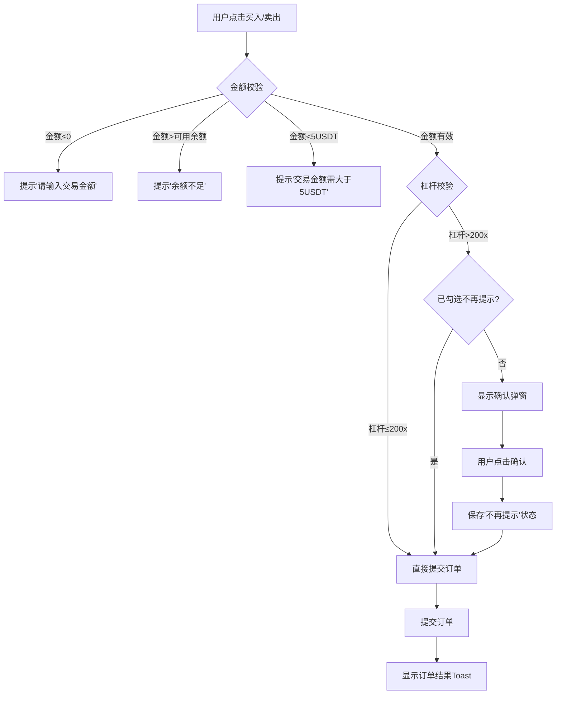
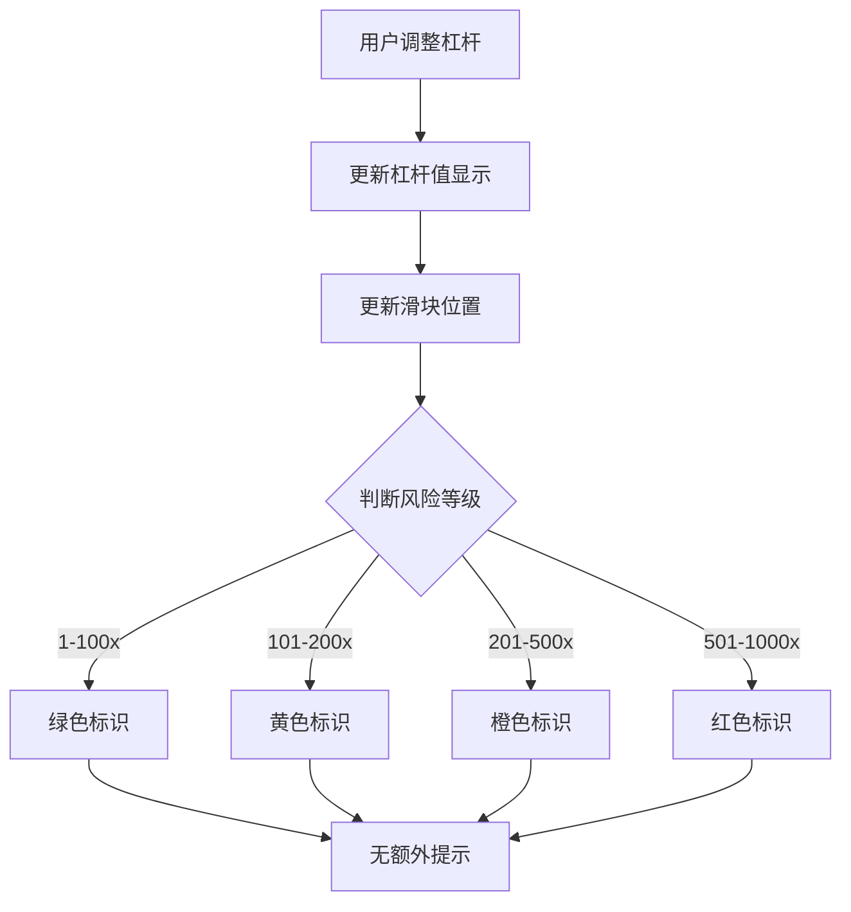

# CEX交易区交互优化需求文档

## 1. 需求概述

### 1.1 背景

基于对主流CEX平台（Binance、OKX、Bybit、KuCoin）交易区交互设计的调研分析，结合实际交互测试反馈，对交易区（下单区）进行系统性优化，提升用户交易体验和风险控制能力。

### 1.2 核心目标

- 优化杠杆选择交互体验
- 完善金额输入与确认机制
- 强化风险提示与确认流程
- 支持中英文双语切换
- 修复滑块交互问题

### 1.3 调整内容清单

| 序号 | 调整项               | 状态 | 说明                     |
| -- | ----------------- | -- | ---------------------- |
| 1  | 高杠杆提示增加「不再提示」勾选框  | ✅  | 高杠杆确认弹窗支持用户选择不再显示      |
| 2  | 移除预估手续费、保证金率、费用选项 | ✅  | 简化界面，聚焦核心交易信息          |
| 3  | 强平价根据买卖方向显示       | ✅  | 买入/卖出按钮下方分别显示对应强平价     |
| 4  | 补充限制订单交互逻辑        | ✅  | 支持限价订单价格输入和百分比提示       |
| 5  | 补充TP/SL订单交互逻辑     | ✅  | 支持止盈止损价格设置和收益计算        |
| 6  | ROI计算器弹窗          | ✅  | 杠杆行后增加计算器图标，点击显示ROI计算器 |
| 7  | 移除底部平仓价信息         | ✅  | 简化界面布局                 |
| 8  | 杠杆范围调整为1-1000倍    | ✅  | 扩大杠杆选择范围               |
| 9  | 风险等级重新划分          | ✅  | 根据新杠杆范围调整风险提示规则        |
| 10 | 滑块交互修复            | ✅  | 修复杠杆和金额滑块无法滑动问题        |
| 11 | 金额百分比滑块点击支持       | ✅  | 支持点击轨道任意位置选择金额         |

***

## 2. 功能需求详细说明

### 2.1 杠杆选择模块

#### 2.1.1 杠杆范围

- **最小值**：1x
- **最大值**：1000x
- **默认值**：20x

#### 2.1.2 风险等级划分

| 杠杆范围         | 风险等级 | 视觉标识 | 交互行为              |
| ------------ | ---- | ---- | ----------------- |
| 1x - 100x    | 低风险  | 绿色滑块 | 无额外提示             |
| 101x - 200x  | 中风险  | 黄色滑块 | 无额外提示             |
| 201x - 500x  | 高风险  | 橙色滑块 | 提交时弹出确认弹窗         |
| 501x - 1000x | 极高风险 | 红色滑块 | 提交时弹出确认弹窗 + 强风险提示 |

#### 2.1.3 交互特性

- ✅ 滑块支持拖拽选择
- ✅ 滑块轨道支持点击定位
- ✅ 显示关键档位标记（1x、100x、200x、500x、750x、1000x）
- ✅ 点击"最大"按钮快速设置为1000x

***

### 2.2 订单类型模块

#### 2.2.1 订单类型列表

| 类型     | 名称（中文）  | 名称（英文）       | 功能描述           |
| ------ | ------- | ------------ | -------------- |
| market | 市场订单    | Market Order | 按当前市价立即成交      |
| limit  | 限价订单    | Limit Order  | 用户指定价格，达到条件时成交 |
| tpsl   | TP/SL订单 | TP/SL Order  | 止盈止损订单，自动平仓    |

#### 2.2.2 限价订单交互

- ✅ 价格输入框，支持数字输入
- ✅ 显示当前价格与输入价格的百分比差异
- ✅ 占位符提示"请输入价格"

#### 2.2.3 TP/SL订单交互

- ✅ 支持市场/限价两种模式选择
- ✅ 止盈价输入，显示预估收益
- ✅ 止损价输入，显示预估亏损
- ✅ 收益/亏损金额实时计算

***

### 2.3 金额输入模块

#### 2.3.1 核心功能

- ✅ USDT金额输入框
- ✅ 百分比快捷按钮（0%、25%、50%、75%、100%）
- ✅ 快捷操作按钮（1/2、2x、T）
- ✅ 自定义百分比滑块

#### 2.3.2 滑块交互特性

- ✅ 支持拖拽调整百分比
- ✅ 支持点击轨道任意位置快速定位
- ✅ 实时显示当前百分比对应的金额
- ✅ 滑块填充区域动态变化

#### 2.3.3 校验规则

| 条件          | 状态 | 提示信息             |
| ----------- | -- | ---------------- |
| 金额 ≤ 可用余额   | 正常 | 无提示              |
| 金额 > 可用余额   | 错误 | 余额不足！可用余额：X USDT |
| 金额 = 可用余额   | 警告 | 满仓操作：建议预留手续费空间   |
| 金额 < 5 USDT | 警告 | 低于最小交易金额（5 USDT） |

***

### 2.4 操作按钮模块

#### 2.4.1 买入/卖出按钮

- ✅ 买入按钮（绿色）：执行买入做多操作
- ✅ 卖出按钮（红色）：执行卖出做空操作
- ✅ 点击触发交易提交流程

#### 2.4.2 强平价显示

- ✅ 买入按钮下方显示买入强平价（左对齐）
- ✅ 卖出按钮下方显示卖出强平价（右对齐）
- ✅ 强平价根据杠杆和金额实时计算

***

### 2.5 ROI计算器模块

#### 2.5.1 触发方式

- ✅ 点击杠杆行右侧计算器图标打开弹窗
- ✅ 弹窗从底部滑入

#### 2.5.2 计算器功能

- ✅ 开仓价输入
- ✅ 交易方向选择（看涨/看跌）
- ✅ 交易量输入（USD）
- ✅ 收益倍数输入
- ✅ 自定义价格波动百分比输入
- ✅ ROI表格实时计算展示

***

### 2.6 确认弹窗模块

#### 2.6.1 触发条件

- 杠杆 > 200x 且未勾选"不再提示"

#### 2.6.2 弹窗内容

- ✅ 订单确认信息（方向、类型、杠杆、金额）
- ✅ 风险提示（高杠杆/极高杠杆）
- ✅ "不再提示"勾选框
- ✅ 取消/确认按钮

#### 2.6.3 风险提示文案

| 杠杆范围       | 提示级别 | 文案内容（中文）                    | 文案内容（英文）                                                                                        |
| ---------- | ---- | --------------------------- | ----------------------------------------------------------------------------------------------- |
| 201x-500x  | 高风险  | ⚠️ 高风险！您正在使用高杠杆，请注意风险控制。    | ⚠️ High Risk! You are using high leverage, please manage your risk.                             |
| 501x-1000x | 极高风险 | ⚠️ 极高风险！您正在使用超高杠杆，可能导致快速爆仓！ | ⚠️ Extremely High Risk! You are using ultra-high leverage, which may lead to rapid liquidation! |

***

### 2.7 多语言支持模块

#### 2.7.1 支持语言

- ✅ 中文（默认）
- ✅ English

#### 2.7.2 切换方式

- ✅ 点击页面右上角语言切换按钮
- ✅ 切换后立即更新所有界面文本

#### 2.7.3 翻译覆盖范围

- 页面标题和标签
- 按钮和操作文本
- 错误提示和消息
- 弹窗内容
- 输入框占位符

***

## 3. 业务逻辑流程

### 3.1 交易提交流程

### 3.2 杠杆选择流程

 

***

## 4. 交互节点说明

### 4.1 核心交互节点

| 节点ID   | 节点名称     | 触发方式       | 响应行为           |
| ------ | -------- | ---------- | -------------- |
| IN-001 | 杠杆滑块拖拽   | 鼠标/触摸拖拽滑块  | 更新杠杆值，实时计算强平价  |
| IN-002 | 杠杆滑块点击   | 点击滑块轨道     | 跳转到对应杠杆值       |
| IN-003 | 最大杠杆按钮   | 点击"最大"按钮   | 设置杠杆为1000x     |
| IN-004 | 订单类型切换   | 点击Tab标签    | 切换显示对应订单输入区域   |
| IN-005 | 金额输入     | 输入框输入      | 实时校验，更新百分比滑块   |
| IN-006 | 百分比快捷按钮  | 点击百分比标记    | 设置对应百分比金额      |
| IN-007 | 金额滑块拖拽   | 鼠标/触摸拖拽    | 更新百分比和金额       |
| IN-008 | 金额滑块点击   | 点击轨道任意位置   | 跳转到对应百分比       |
| IN-009 | 快捷操作按钮   | 点击1/2、2x、T | 快速调整金额         |
| IN-010 | 买入按钮     | 点击买入按钮     | 触发交易提交流程       |
| IN-011 | 卖出按钮     | 点击卖出按钮     | 触发交易提交流程       |
| IN-012 | ROI计算器图标 | 点击计算器图标    | 打开ROI计算器弹窗     |
| IN-013 | 确认弹窗确认   | 点击确认按钮     | 提交订单并保存偏好设置    |
| IN-014 | 确认弹窗取消   | 点击取消按钮     | 关闭弹窗，不提交订单     |
| IN-015 | 语言切换     | 点击语言按钮     | 切换界面语言         |
| IN-016 | TP/SL开关  | 切换开关状态     | 显示/隐藏TP/SL设置区域 |

### 4.2 状态转换节点

| 状态    | 触发条件            | 下一状态             |
| ----- | --------------- | ---------------- |
| 默认状态  | 进入交易区           | 显示默认值（杠杆20x，金额0） |
| 杠杆调整中 | 拖动/点击杠杆滑块       | 实时更新杠杆值和强平价      |
| 金额输入中 | 在金额框输入          | 实时校验并更新滑块位置      |
| 高杠杆确认 | 杠杆>200x且未勾选不再提示 | 显示确认弹窗           |
| 订单提交中 | 通过所有校验          | 提交订单并显示结果        |
| 错误状态  | 校验失败            | 显示错误提示，保持当前输入    |

***

## 5. 异常处理机制

### 5.1 错误类型分类

| 错误级别 | 错误类型   | 触发场景           | 处理方式           |
| ---- | ------ | -------------- | -------------- |
| 警告   | 满仓操作   | 金额=可用余额        | 黄色边框 + Toast提示 |
| 警告   | 最小金额不足 | 金额<5USDT（特定场景） | 黄色边框 + Toast提示 |
| 错误   | 余额不足   | 金额>可用余额        | 红色边框 + Toast提示 |
| 错误   | 金额为空   | 金额≤0           | Toast提示        |
| 确认   | 高杠杆交易  | 杠杆>200x        | 弹出确认弹窗         |

### 5.2 提示展示方式

| 方式      | 适用场景   | 视觉效果                 |
| ------- | ------ | -------------------- |
| 输入框边框变色 | 实时校验错误 | 红色（错误）/黄色（警告）/正常（绿色） |
| Toast提示 | 操作反馈   | 顶部弹出，3秒自动消失          |
| 弹窗确认    | 高风险操作  | 居中弹窗，需用户确认           |
| 行内提示    | 输入校验   | 输入框下方显示错误文字          |

***

## 6. 原型文件说明

### 6.1 文件位置

- **交互原型**：`交易区交互逻辑与提示内容.html`
- **需求文档**：`trading-area-requirements.md`（本文件）

### 6.2 原型功能覆盖

- ✅ 完整交易区布局
- ✅ 杠杆选择与风险可视化
- ✅ 订单类型切换
- ✅ 金额输入与校验
- ✅ 买入/卖出操作
- ✅ 强平价显示
- ✅ 确认弹窗与风险提示
- ✅ ROI计算器
- ✅ 中英文切换
- ✅ 场景演示功能

***

