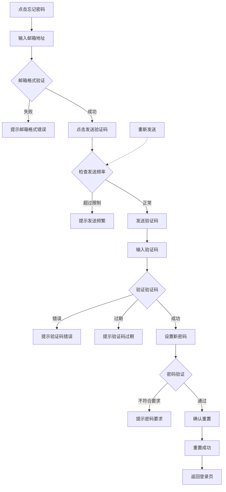

# DeTrade 忘记密码重置功能 PRD

## 1. 文档概述

**项目名称**: DeTrade Forgot Password Reset
**核心目标**: 优化用户密码重置流程，从直接发送新密码改为安全的验证码验证流程，提升账户安全性和用户体验。

***

## 2. 现有流程问题分析

### 当前流程（存在的问题）

1. 用户点击"忘记密码"按钮
2. 系统直接发送新密码到用户邮箱
3. 用户使用新密码登录
4. **问题**：
   - 安全性不足：直接发送密码存在被拦截风险
   - 用户体验差：用户无法自己设置熟悉的密码
   - 缺少身份验证环节

***

## 3. 新功能设计方案

### 3.1 新流程设计

#### 步骤1: 触发重置入口

- **位置**: 登录页面底部"Forgot password"链接
- **交互**: 点击后弹出/跳转至重置密码页面

#### 步骤2: 输入邮箱地址

- 用户输入注册时使用的邮箱地址
- 前端验证邮箱格式
- 点击"发送验证码"按钮

#### 步骤3: 发送验证码

- 系统向用户邮箱发送6位数字验证码
- 验证码有效期：10分钟
- 限制发送频率：每分钟1次，每小时5次

#### 步骤4: 输入验证码

- 用户输入收到的验证码
- 实时验证验证码是否正确
- 提供"重新发送"按钮（倒计时60秒）

#### 步骤5: 设置新密码

- 验证通过后，显示密码输入框
- 要求：
  - 密码长度至少8位
  - 包含字母和数字
  - 确认密码需与新密码一致
- 点击"确认重置"按钮

#### 步骤6: 重置成功

- 显示成功提示
- 提供"返回登录"按钮
- 清除所有临时会话数据

***

## 4. 核心业务流程 (Core Workflows)



***

## 5. 功能需求详情 (Functional Requirements)

### 5.1 前端交互 (App/Web)

#### 页面1: 邮箱输入页

- **标题**: 忘记密码
- **输入框**: 邮箱地址
- **按钮**:
  - 发送验证码（初始可用）
  - 返回登录
- **验证**:
  - 实时邮箱格式验证
  - 邮箱为空时禁用发送按钮

#### 页面2: 验证码输入页

- **显示**:
  - 已输入的邮箱（带掩码，如 u\*\*\*@example.com）
  - 提示信息：验证码已发送至您的邮箱
- **输入框**: 6位数字验证码
- **按钮**:
  - 下一步（需输入完整验证码后可用）
  - 重新发送（60秒倒计时，期间禁用）
  - 返回
- **交互**: 自动聚焦下一个输入框

#### 页面3: 密码设置页

- **输入框**:
  - 新密码
  - 确认密码
- **密码强度提示**:
  - 弱：仅字母或仅数字
  - 中：字母+数字
  - 强：字母+数字+特殊字符
- **按钮**:
  - 确认重置
  - 返回

#### 页面4: 成功提示页

- **图标**: 成功绿色对勾
- **文字**: 密码重置成功！
- **按钮**: 立即登录

### 5.2 后端API设计

| 接口                                      | 方法   | 说明    |
| --------------------------------------- | ---- | ----- |
| `/api/auth/forgot-password/send-code`   | POST | 发送验证码 |
| `/api/auth/forgot-password/verify-code` | POST | 验证验证码 |
| `/api/auth/forgot-password/reset`       | POST | 重置密码  |

#### API详情

**发送验证码**

```json
POST /api/auth/forgot-password/send-code
{
  "email": "user@example.com"
}

Response:
{
  "success": true,
  "message": "验证码已发送",
  "expires_in": 600
}
```

**验证验证码**

```json
POST /api/auth/forgot-password/verify-code
{
  "email": "user@example.com",
  "code": "123456"
}

Response:
{
  "success": true,
  "message": "验证成功",
  "verify_token": "xxx" // 用于下一步重置密码
}
```

**重置密码**

```json
POST /api/auth/forgot-password/reset
{
  "email": "user@example.com",
  "verify_token": "xxx",
  "new_password": "NewPass123!"
}

Response:
{
  "success": true,
  "message": "密码重置成功"
}
```

### 5.3 后台管理 (Admin)

- **日志记录**: 记录所有密码重置操作（时间、IP、邮箱）
- **统计**: 可查看密码重置频率统计
- **风控**: 异常重置行为预警

***

## 6. 安全性设计

### 6.1 验证码安全

- **有效期**: 10分钟过期
- **防暴力破解**: 验证码错误5次后锁定30分钟
- **发送频率限制**:
  - 每分钟最多1次
  - 每小时最多5次
  - 每天最多10次
- **一次性使用**: 验证码验证成功后立即失效

### 6.2 密码安全

- **密码强度要求**:
  - 最小长度：8位
  - 必须包含字母和数字
  - 建议包含特殊字符
- **密码加密**: 使用bcrypt或Argon2加密存储
- **历史密码检查**: 不能使用最近3次使用过的密码

### 6.3 其他安全措施

- **会话超时**: 整个重置流程超时时间15分钟
- **IP限制**: 同一IP短时间内多次重置需要验证码
- **通知**: 密码重置成功后发送邮件通知用户

***

## 7. 用户文案与国际化

### 中文文案

- 忘记密码
- 请输入您的注册邮箱
- 发送验证码
- 验证码已发送至您的邮箱
- 请输入6位验证码
- 重新发送
- 秒后重发
- 设置新密码
- 密码长度至少8位，包含字母和数字
- 确认密码
- 确认重置
- 密码重置成功！
- 返回登录

### 英文文案

- Forgot Password
- Please enter your registered email
- Send Verification Code
- Verification code sent to your email
- Enter 6-digit code
- Resend
- seconds to resend
- Set New Password
- Password must be at least 8 characters with letters and numbers
- Confirm Password
- Confirm Reset
- Password reset successful!
- Back to Login

***

## 8. 邮件模板设计

### 验证码邮件模板

**主题**: DeTrade - 您的密码重置验证码
**内容**:

```
尊敬的用户，

您正在进行密码重置操作，您的验证码是：

123456

该验证码将在10分钟后过期。

如果这不是您本人的操作，请忽略此邮件。

DeTrade 团队
```

### 重置成功通知邮件

**主题**: DeTrade - 您的密码已成功重置
**内容**:

```
尊敬的用户，

您的账户密码已成功重置。如果这不是您本人的操作，请立即联系我们的客服团队。

DeTrade 团队
```

***

## 9. 验收标准

### 功能验收

- [ ] 可以正常触发忘记密码流程
- [ ] 邮箱格式验证正确
- [ ] 验证码发送成功
- [ ] 验证码可以正确验证
- [ ] 密码重置成功
- [ ] 可以使用新密码登录

### 安全验收

- [ ] 验证码过期机制正常
- [ ] 发送频率限制有效
- [ ] 密码强度检查生效
- [ ] 所有操作有日志记录

### 用户体验验收

- [ ] 界面清晰友好
- [ ] 错误提示明确
- [ ] 流程顺畅无卡顿
- [ ] 中英文切换正常

